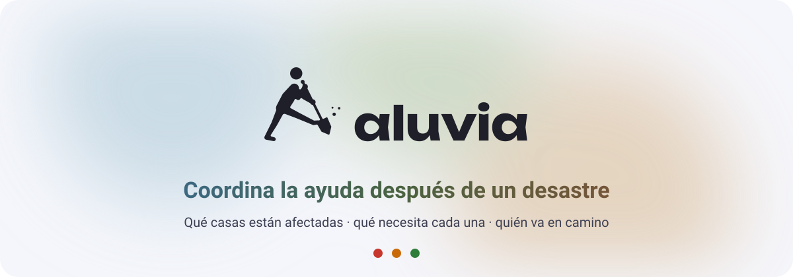
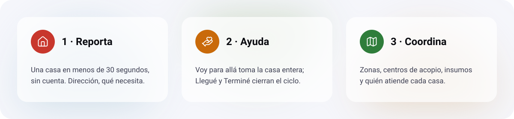

<p align="center">
  <a href="https://aluvia.cl">
    <picture>
      <source media="(prefers-color-scheme: dark)" srcset="docs/brand/readme/hero-dark.svg">
      
    </picture>
  </a>
</p>

<p align="center">
  <a href="https://aluvia.cl"></a>
  <a href="https://github.com/srdanirz/Aluvia/actions/workflows/ci.yml"></a>
  <a href="LICENSE"></a>
  
  
</p>

<p align="center">
  <a href="https://aluvia.cl"><b>Abrir Aluvia</b></a> ·
  <a href="https://aluvia.cl/es/feedback">Enviar comentarios</a> ·
  <a href="CONTRIBUTING.md">Contribuir</a> ·
  <a href="docs/README.md">Investigación</a>
</p>

---

Después de un aluvión, la ayuda llega rápido y desordenada: cientos de voluntarios, grupos de WhatsApp que se cruzan, casas que reciben tres visitas y casas que no reciben ninguna. **Aluvia es un mapa compartido de lo que pasa en cada casa**: qué está afectada, qué necesita, quién va en camino y dónde hace falta gente.

Nació en Las Condes, después del aluvión del 8 de octubre de 2026 en San Carlos de Apoquindo. La hicimos dos vecinos, Daniel y Santiago, con mucho cariño para nuestra comuna. Es open source y sirve para cualquier comuna o ciudad, ante un aluvión, una inundación, un incendio u otro desastre parecido.

<p align="center">
  <picture>
    <source media="(prefers-color-scheme: dark)" srcset="docs/brand/readme/flow-dark.svg">
    
  </picture>
</p>

## Qué hace

| | |
|---|---|
| **Reportar sin cuenta** | Una casa en menos de 30 segundos: dirección escrita, qué necesita, fotos o video. Google la ubica en el mapa y la une a su predio oficial. |
| **Mapa con semáforo** | Rojo sin atender, naranjo en curso, verde atendida. Zonas de no entrar, de acceso restringido y puntos de encuentro dibujadas sobre el mapa. |
| **Reportes** | Dónde se necesita más ayuda primero: personas en peligro, más vecinos reportando, más trabajos sin tomar, más tiempo esperando. |
| **Voy para allá** | Un voluntario toma una casa entera, marca Llegué y Terminé. Cuántas personas van se ve en cada casa, sin nombrarlas. |
| **Aporte abierto** | Cualquiera actualiza personas trabajando, insumos que faltan y el estado de una casa, sin cuenta. Los coordinadores pueden deshacer. |
| **Insumos** | Lo que más falta en las casas y lo que sobra en los centros de acopio, para llevar lo útil y no llenar los centros. |
| **Coordinación** | Organizaciones con sus propios coordinadores, centros de acopio, turnos y avisos por WhatsApp y SMS. |

## Cómo lo pensamos

- **Sin fricción.** Usar Aluvia tiene que ser más fácil que subir una historia de Instagram: sin cuenta para reportar ni para mirar, y nada se pierde sin señal.
- **Datos personales con cuidado.** La dirección es pública porque el voluntario tiene que encontrar la puerta; nombre y teléfono solo si el vecino lo elige. Nada real entra al repositorio. [SECURITY.md](SECURITY.md)
- **Para cualquier desastre.** Tipos de desastre, trabajos e insumos se configuran por emergencia desde el admin, no en el código.
- **Hecho para el teléfono.** Celular, tablet y escritorio, tema claro y oscuro, español e inglés desde el primer día.

## Stack

| | |
|---|---|
| App | Next.js 16 (App Router, Cache Components), React 19, TypeScript |
| Datos | Postgres con PostGIS, Drizzle ORM |
| Mapa | Google Maps (`@vis.gl/react-google-maps`), geocodificación de direcciones |
| UI | Tailwind CSS 4 con un design system cerrado en `src/shared/ui` ([DESIGN.md](docs/DESIGN.md)) |
| Infra | GCP: Cloud Run, Cloud SQL, Cloud Storage, Secret Manager, Terraform en [`infra/`](infra/) |
| Calidad | Vitest con Postgres real por test, CI en cada push, despliegue automático a producción |

## Correr en local

Requiere Node 22, pnpm 10 y Docker.

```bash
pnpm install
cp .env.example .env.local
pnpm db:up && pnpm db:migrate
pnpm dev          # app en http://localhost:3002
pnpm db:studio    # base de datos en https://local.drizzle.studio/?port=3003
```

| Servicio | Puerto |
|---|---|
| App (Next.js) | 3002 |
| Drizzle Studio | 3003 |
| Postgres + PostGIS | 5440 |

`pnpm check` revisa tipos, lint y formato. Los tests y el build corren en el CI con cada push, porque cada corrida levanta su propio Postgres. Catálogo del design system: http://localhost:3002/es/dev/ui

## Contribuir

¿Eres dev, diseñador o conoces de emergencias? Toda ayuda suma.

1. Lee [CONTRIBUTING.md](CONTRIBUTING.md) y [AGENTS.md](AGENTS.md): cómo trabajamos y las reglas que no se negocian.
2. Elige un [issue abierto](https://github.com/srdanirz/Aluvia/issues) o propone uno.
3. Todo entra por Pull Request con revisión cruzada; el CI tiene que pasar.

Documentación: [investigación y contexto](docs/README.md) · [decisiones de arquitectura](docs/adr/) · [mapa del código](docs/CODE_MAP.md) · [STYLEGUIDE](docs/STYLEGUIDE.md) · [DESIGN](docs/DESIGN.md)

## Licencia

[MIT](LICENSE). Úsala, adáptala a tu comuna y cuéntanos.
